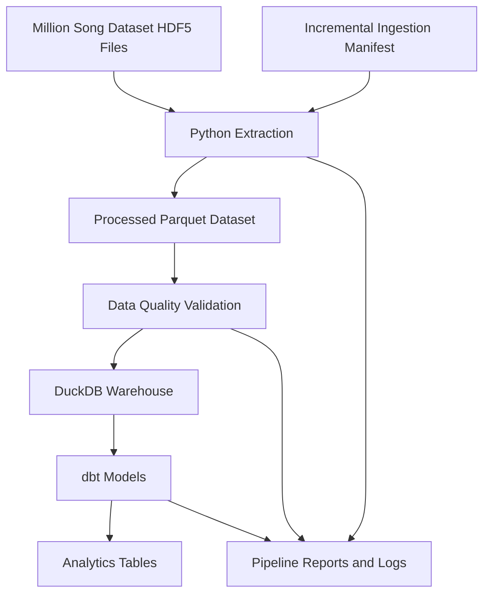

# Million Song Dataset Analytics Pipeline

An end-to-end Data Engineering project that transforms raw Million Song Dataset HDF5 files into an analytics-ready Parquet dataset, loads analytical models into DuckDB using dbt, and validates data quality through automated tests.

## Overview

This project demonstrates how to build a reliable, repeatable data pipeline using Python, Parquet, DuckDB, and dbt.

The pipeline extracts audio and artist metadata from the Million Song Dataset subset, tracks source-file changes through an ingestion manifest, and prepares analytical tables for downstream querying and reporting.

The current local dataset contains **10,000 songs**.

### Key capabilities

- **Incremental ingestion:** Detect new, modified, and deleted source files.
- **Columnar storage:** Store extracted song metadata in Parquet.
- **Analytical warehouse:** Use DuckDB for local analytical queries.
- **Data transformation:** Build staging, dimension, fact, and summary models with dbt.
- **Data quality:** Validate record counts, unique identifiers, and pipeline outputs.
- **Automated testing:** Test extraction and pipeline behavior using pytest.
- **Observability:** Generate execution logs and structured pipeline reports.
- **Repeatable execution:** Run the pipeline locally without paid cloud infrastructure.

## Architecture



## Technology stack

| Technology        | Purpose                                               |
| ----------------- | ----------------------------------------------------- |
| Python            | Extraction, orchestration, validation, and automation |
| HDF5 / h5py       | Reading source song metadata                          |
| Pandas            | Data manipulation and transformation                  |
| PyArrow / Parquet | Efficient columnar storage                            |
| DuckDB            | Local analytical warehouse                            |
| dbt               | SQL-based modeling and data testing                   |
| pytest            | Automated testing                                     |
| Git / GitHub      | Version control and project presentation              |

## Dataset and extracted fields

The project uses the local Million Song Dataset subset, consisting of 10,000 HDF5 files.

The extracted schema includes metadata such as:

- Track and song identifiers
- Song title
- Artist identifier and name
- Artist location and coordinates
- Release and year
- Genre
- Duration, tempo, and loudness
- Danceability and energy
- Musical key, mode, and time signature
- Song hotness, artist hotness, and artist familiarity
- Source-file path and ingestion timestamp

The dataset is intended for analytical exploration. The subset does not represent the entire Million Song Dataset, and some fields may contain missing or unavailable values.

## Data engineering workflow

### 1. Extraction

Python reads the source HDF5 files and extracts the required metadata into a structured tabular dataset.

### 2. Incremental ingestion

The ingestion manifest stores source-file signatures, including file size and modification time. The extractor uses these signatures to identify files that need processing.

The intended incremental behavior is to:

- Process new files.
- Reprocess changed files.
- Remove records associated with deleted source files.
- Preserve previous valid records when a changed file cannot be processed.
- Avoid unnecessary work for unchanged files.

### 3. Parquet storage

Extracted data is written to `data/processed/songs.parquet`.

Parquet provides columnar storage that is suitable for analytical workloads. Data-quality checks should verify the expected schema, record counts, and uniqueness constraints.

### 4. Warehouse and transformations

DuckDB provides a local analytical warehouse. The dbt project builds the following models:

| Model                   | Purpose                              |
| ----------------------- | ------------------------------------ |
| `stg_songs`           | Staging view for extracted song data |
| `dim_artists`         | Artist dimension                     |
| `fct_song_audio`      | Song-level audio features            |
| `song_yearly_summary` | Aggregated summary by year           |

The exact business rules and grain of each model are defined in the SQL model files.

### 5. Testing and reporting

The pipeline orchestrator executes extraction, dbt transformations, and dbt tests, then collects relevant execution metrics and writes a structured report.

The pipeline should fail clearly when a required stage or data-quality check fails.

## Repository structure

```text
million-song-data-pipeline/
├── data/
│   ├── raw/
│   │   └── MillionSongSubset/
│   ├── processed/
│   │   ├── songs.parquet
│   │   ├── ingestion_manifest.json
│   │   └── extraction_errors.csv
│   └── warehouse/
│       └── music_analytics.duckdb
├── music_analytics/
│   ├── models/
│   │   ├── staging/
│   │   └── ...
│   └── dbt_project.yml
├── src/
│   └── processing/
│       └── extract_to_parquet.py
├── tests/
├── reports/
├── run_pipeline.py
├── requirements.txt
├── .gitignore
└── README.md
```

This is a logical overview. Confirm the actual folders and filenames in the repository before treating it as an exact file listing.

## Setup

### Prerequisites

- Python compatible with the project's installed dependencies
- Git
- The Million Song Dataset subset, available locally
- A configured dbt profile for DuckDB

### 1. Clone the repository

```powershell
git clone <YOUR_GITHUB_REPOSITORY_URL>
cd million-song-data-pipeline
```

### 2. Create a virtual environment

On Windows PowerShell:

```powershell
python -m venv .venv
.\.venv\Scripts\Activate.ps1
```

If PowerShell blocks activation, you can run the environment's Python executable directly without activating it.

### 3. Install dependencies

```powershell
.\.venv\Scripts\python -m pip install -r requirements.txt
```

Confirm that the raw dataset is available at the expected location and that the DuckDB/dbt configuration matches your local environment.

## Running the pipeline

Run the extraction step independently:

```powershell
.\.venv\Scripts\python -m src.processing.extract_to_parquet
```

Run automated tests:

```powershell
.\.venv\Scripts\python -m pytest -q
```

Run the complete pipeline:

```powershell
.\.venv\Scripts\python run_pipeline.py
```

The complete pipeline should execute the configured extraction, validation, transformation, and testing stages.

## Example validation results

Latest results reported during local development:

| Check                  |                 Result |
| ---------------------- | ---------------------: |
| Source dataset size    |           10,000 files |
| Extracted Parquet rows |                 10,000 |
| Unique track IDs       |                 10,000 |
| Unique source files    |                 10,000 |
| Automated tests        |              17 passed |
| Pipeline execution     | Completed successfully |

These results describe the reported development run. Re-run the pipeline and tests to reproduce them in your environment.

## Data quality and reliability

The project aims to enforce the following safeguards:

- Parquet files must be readable.
- Required columns must exist.
- Track identifiers and source-file keys must satisfy uniqueness requirements.
- Extraction errors must be reported.
- Incremental updates must not silently duplicate records.
- Failed processing must not destroy the last valid output.
- dbt model and test failures must be visible in the pipeline result.

Incremental ingestion should be tested with new, changed, deleted, and unreadable source files before being considered fully reliable.

## Example analytical queries

Once the corresponding dbt models have been built, you can query them in DuckDB.

Example: inspect the song-level audio table.

```sql
SELECT
    track_id,
    title,
    artist_name,
    duration_seconds,
    tempo,
    loudness
FROM analytics.fct_song_audio
LIMIT 10;
```

Example: inspect yearly aggregates.

```sql
SELECT *
FROM analytics.song_yearly_summary
ORDER BY year;
```

Example: find artists with the most tracks in the extracted subset.

```sql
SELECT
    artist_name,
    COUNT(*) AS track_count
FROM analytics.fct_song_audio
GROUP BY artist_name
ORDER BY track_count DESC
LIMIT 20;
```

Check the actual model column names and configured schema if your local dbt models differ from these examples.

## Engineering decisions

**Why Parquet?**
It stores structured data efficiently in a columnar format and works well with analytical engines.

**Why DuckDB?**
It provides fast analytical SQL locally without requiring a separately managed database server.

**Why dbt?**
It organizes SQL transformations into reusable models and provides a framework for testing data assumptions.

**Why incremental ingestion?**
It avoids repeatedly processing unchanged files and supports more efficient reruns as source data changes.

**Why automated tests?**
They help detect regressions in extraction, incremental behavior, data integrity, and orchestration.

## Limitations

- The project currently uses a 10,000-file dataset subset rather than the complete Million Song Dataset.
- It is a local batch-processing pipeline, not a live streaming system.
- It does not claim cloud-scale performance or distributed processing.
- Incremental ingestion reliability depends on the correctness of source signatures, manifest reconciliation, and failure handling.
- The reported metrics are local development results, not independently benchmarked production SLAs.

## Future improvements

- Add a CI workflow that runs unit tests and quality checks on each pull request.
- Add integration tests for changed and deleted source files.
- Add data lineage and schema-change detection.
- Add reproducible data-quality summaries and historical run metrics.
- Add containerized execution for consistent environments.
- Add optional cloud object storage and orchestration when a cloud deployment is justified.
- Add analytical dashboards based on the curated warehouse tables.

## Author

Built as a hands-on Data Engineering portfolio project focused on Python, incremental data processing, columnar storage, SQL transformations, analytics, and automated validation.

If you find the project useful, feel free to explore the implementation, raise issues, or suggest improvements.
