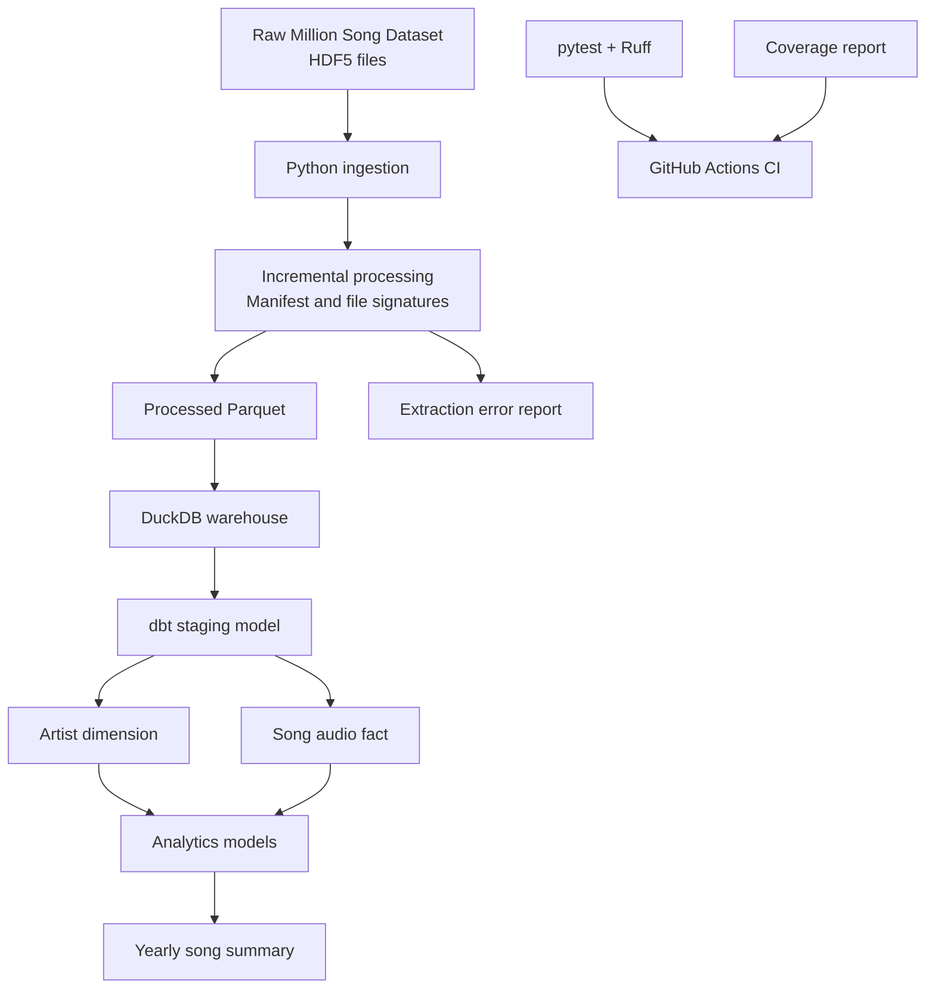

# Million Song Dataset — Data Engineering Pipeline

A reproducible data engineering project that transforms raw song metadata stored in HDF5 files into analytics-ready Parquet datasets and a DuckDB warehouse, with dbt transformations, automated data pipeline tests, and continuous integration.


## Project Overview

Working with raw datasets requires more than extracting data. A reliable pipeline must handle changing source files, preserve data integrity, transform records into analytical models, and validate its behavior through automated tests.

This project implements a local-first data engineering workflow for the Million Song Dataset subset. It uses Python for extraction and incremental processing, Parquet for columnar storage, DuckDB as the analytical warehouse, dbt for data modeling, and GitHub Actions for continuous integration.

### Key Features

- **HDF5 ingestion:** Extracts song and artist metadata from the raw dataset.
- **Incremental processing:** Tracks source-file signatures in an ingestion manifest to identify new or modified files.
- **Change handling:** Supports reprocessing changed files and accounting for removed source files.
- **Parquet storage:** Stores processed song records in a columnar format.
- **Failure handling:** Records extraction errors and supports retrying failed files.
- **Analytical warehouse:** Uses DuckDB to query structured song data.
- **dbt transformations:** Builds staging, dimension, fact, and summary models.
- **Automated testing:** Uses pytest to validate extraction and warehouse behavior.
- **Code quality:** Uses Ruff for Python linting.
- **Continuous integration:** Runs automated checks through GitHub Actions and uploads a coverage report.

## Architecture



## Technology Stack

| Component                | Technology     | Purpose                                |
| ------------------------ | -------------- | -------------------------------------- |
| Programming language     | Python         | Ingestion, processing, orchestration   |
| Source format            | HDF5           | Raw song and artist metadata           |
| Processed storage        | Parquet        | Columnar data storage                  |
| Analytical database      | DuckDB         | Local analytical warehouse             |
| Transformation framework | dbt            | SQL modeling and data tests            |
| Testing                  | pytest         | Automated regression and unit tests    |
| Code quality             | Ruff           | Python linting                         |
| CI/CD checks             | GitHub Actions | Automated checks on repository changes |

## Data Pipeline

### 1. Extract

The ingestion process reads the source HDF5 files and extracts relevant attributes, including:

- Track and song identifiers
- Song title and artist information
- Artist location and coordinates, when available
- Release and year
- Duration, tempo, and loudness
- Danceability, energy, key, mode, and time signature
- Song and artist popularity-related attributes

The extractor normalizes relevant data types and writes structured records to Parquet.

### 2. Process incrementally

An ingestion manifest records source-file signatures so that the pipeline can determine which files need processing.

The incremental workflow is designed to:

- Process newly discovered files
- Reprocess files whose tracked signatures change
- Avoid reprocessing unchanged files unnecessarily
- Account for source files that have been removed
- Preserve existing records when appropriate if a replacement file fails
- Record extraction failures for diagnosis and retry

The manifest is maintained at:

`data/processed/ingestion_manifest.json`

### 3. Store processed data

The main processed dataset is:

`data/processed/songs.parquet`

The pipeline uses Parquet to retain a structured representation of the extracted records for downstream analytical processing.

### 4. Build the analytical warehouse

DuckDB provides a local analytical database without requiring a separate database server.

The warehouse file is:

`data/warehouse/music_analytics.duckdb`

The dbt project builds analytical models on top of the available song data.

### 5. Transform with dbt

The project includes the following models:

| Model                   | Materialization | Purpose                        |
| ----------------------- | --------------- | ------------------------------ |
| `stg_songs`           | View            | Staging layer for song records |
| `dim_artists`         | Table           | Artist dimension               |
| `fct_song_audio`      | Table           | Song-level audio attributes    |
| `song_yearly_summary` | Table           | Summary of songs by year       |

The staging layer provides a consistent foundation for downstream analytical models, while the dimension, fact, and summary models organize the data for analytical queries.

### 6. Test and validate

The automated tests validate important pipeline behavior without requiring the full local dataset for every test. Synthetic fixtures and temporary resources help keep tests reproducible.

The project also uses Ruff to detect Python code-quality issues.

## Current Validation Results

The following results were verified during local development:

| Check                      |               Result |
| -------------------------- | -------------------: |
| Extracted song records     |               10,000 |
| Unique track IDs           |               10,000 |
| Unique source files        |               10,000 |
| Ingestion manifest entries |               10,000 |
| Artist dimension rows      |                3,888 |
| Song audio fact rows       |               10,000 |
| Yearly summary rows        |                   68 |
| Automated tests            | 25 passed, 1 skipped |
| Overall source coverage    |                  89% |
| Extractor coverage         |                  88% |
| Warehouse builder coverage |                  96% |
| Ruff linting               |               Passed |
| GitHub Actions CI          |           Successful |

These figures describe the dataset and local test run used during development. Results can differ if the source data or implementation changes.

## Getting Started

### Prerequisites

- Python 3.13
- Git
- Access to the Million Song Dataset subset used by this project
- The raw HDF5 files arranged in the directory structure expected by the extractor

### 1. Clone the repository

```powershell
git clone <YOUR_GITHUB_REPOSITORY_URL>
cd million-song-data-pipeline
```

Replace the placeholder with your actual repository URL.

### 2. Create a virtual environment

```powershell
py -3.13 -m venv .venv
.\.venv\Scripts\Activate.ps1
```

If PowerShell prevents environment activation, you can use the virtual environment's Python executable directly.

### 3. Install dependencies

```powershell
python -m pip install --upgrade pip
python -m pip install -r requirements.txt
```

### 4. Prepare the dataset

Place the raw HDF5 files in the location expected by the ingestion configuration. In the development setup, the source directory is:

`data/raw/MillionSongSubset`

Do not commit the full raw dataset, generated Parquet files, or local warehouse database to Git unless there is a specific reason to distribute them.

### 5. Configure dbt

The dbt profile is configured locally in:

`%USERPROFILE%\.dbt\profiles.yml`

Update the profile to match the project's `dbt_project.yml`, the installed DuckDB adapter, and your local warehouse path. Do not commit machine-specific profile settings or credentials.

### 6. Run the pipeline

From the project root, run:

```powershell
python run_pipeline.py
```

The orchestration script coordinates the configured pipeline stages, including extraction, dbt execution, testing, and reporting.

Consult the current script and project configuration if you need to run an individual stage independently.

## Development and Quality Checks

Run the automated tests:

```powershell
python -m pytest -q
```

Run Ruff:

```powershell
python -m ruff check src tests run_pipeline.py
```

Generate a coverage report:

```powershell
python -m pytest --cov=src --cov-report=term-missing --cov-report=xml:coverage.xml -q
```

The terminal report shows which statements are covered, and the XML report can be consumed by compatible coverage-reporting tools.

## Continuous Integration

The GitHub Actions workflow is located at:

`.github/workflows/ci.yml`

The workflow checks out the repository, sets up Python, installs dependencies, checks Python syntax, runs Ruff and pytest, generates a coverage report, and uploads the report as an artifact.

The workflow was verified to complete successfully in GitHub Actions during development.

To inspect the latest run, open the repository on GitHub and select **Actions**.

## Project Structure

```text
million-song-data-pipeline/
├── .github/
│   └── workflows/
│       └── ci.yml
├── data/
│   ├── raw/
│   │   └── MillionSongSubset/
│   ├── processed/
│   │   ├── songs.parquet
│   │   └── ingestion_manifest.json
│   └── warehouse/
│       └── music_analytics.duckdb
├── music_analytics/
│   ├── models/
│   └── dbt_project.yml
├── src/
│   ├── ingestion/
│   ├── processing/
│   │   └── extract_to_parquet.py
│   ├── storage/
│   ├── utils/
│   └── warehouse/
│       └── build_warehouse.py
├── tests/
├── run_pipeline.py
├── requirements.txt
└── README.md
```

This is a high-level representation of the project. Verify the exact directory names against the current repository before publishing.

## Engineering Practices Demonstrated

- Incremental ingestion and source-file change detection
- Structured storage using Parquet
- Analytical modeling using DuckDB and dbt
- Separation of ingestion, processing, and warehouse responsibilities
- Error reporting and recovery-oriented processing
- Automated regression testing
- Python linting and continuous integration
- Test coverage measurement and reproducible validation

## Future Improvements

Potential extensions include:

- Add dedicated tests for pipeline orchestration and remaining extraction edge cases.
- Introduce explicit data-quality checks for required fields, uniqueness, and valid ranges.
- Add a documented set of sample analytical SQL queries.
- Add query-performance benchmarks and execution plans.
- Publish a reproducible architecture diagram and sample query results.
- Explore cloud storage and orchestration when a deployment environment becomes available.

## License and Dataset Attribution

Before redistributing the source dataset or publishing derived data, check the applicable Million Song Dataset terms and the licensing requirements of any additional sources. Add the project's software license and the dataset attribution details once they have been confirmed.

---

**Built as a hands-on data engineering portfolio project focused on reliable ingestion, incremental processing, analytical modeling, testing, and automation.**
