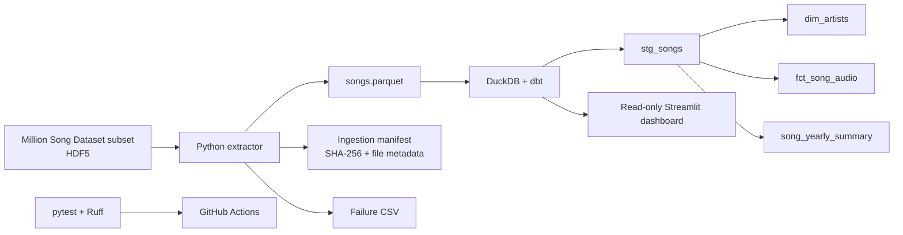

# Million Song Dataset Data Engineering Pipeline

[](https://www.python.org/)
[](https://duckdb.org/)
[](https://www.getdbt.com/)
[](https://pytest.org/)
[](https://github.com/hussainali99a/Million-Song-Dataset-Analytics-Pipeline/actions/workflows/ci.yml)

A local-first pipeline that incrementally extracts song metadata from HDF5 files, stores it as Parquet, models it in DuckDB with dbt, and exposes the analytics through a read-only Streamlit dashboard.

## Problem and objectives

Raw music metadata needs repeatable ingestion, failure recovery, consistent analytical models, and checks that can run without distributing the source dataset. This project demonstrates those concerns using local files and open-source tools rather than hosted infrastructure.

## Architecture



## Technology

| Area | Tools |
| --- | --- |
| Extraction and orchestration | Python 3.13, h5py, pandas |
| Processed storage | Parquet, PyArrow |
| Analytics warehouse | DuckDB |
| SQL transformations | dbt Core, dbt-duckdb |
| Dashboard | Streamlit, Plotly |
| Quality checks | pytest, pytest-cov, Ruff, GitHub Actions |

## Pipeline and data models

`python run_pipeline.py` orchestrates three stages: HDF5 extraction, `dbt run`, and `dbt test`. The extractor scans the dataset recursively, stores a manifest at `data/processed/ingestion_manifest.json`, and writes `data/processed/songs.parquet`. It tracks file size, modification time, and SHA-256 content hashes; unchanged files are skipped, modified files are replaced, and deleted sources are reconciled. Failed files are recorded in `data/processed/extraction_errors.csv`; when a changed file fails, its prior valid row is retained so a later run can retry it.

On the first run after upgrading an older manifest without hashes, the extractor computes hashes and reprocesses files to establish content-aware signatures. Subsequent unchanged runs skip them.

Each subprocess stage has a 30-minute default timeout. Set `MUSIC_PIPELINE_TIMEOUT_SECONDS` to change the default for all stages, or use a stage override such as `MUSIC_PIPELINE_TIMEOUT_BUILD_DBT_MODELS_SECONDS=600`. Values must be positive finite seconds. A timed-out child is terminated and killed if it does not exit within the five-second termination grace period; the pipeline records the failed stage and stops before downstream stages. Ctrl+C also terminates the active child before the pipeline writes a cancelled run report.

The dbt project builds these models in the `analytics` schema:

| Model | Grain | Description |
| --- | --- | --- |
| `stg_songs` | One row per source track | Cleaned view over the processed Parquet data |
| `dim_artists` | One row per artist ID | Artist names and artist-level aggregates |
| `fct_song_audio` | One row per track | Track metadata and audio features |
| `song_yearly_summary` | One row per valid release year | Song counts and average audio features |

`src/warehouse/build_warehouse.py` is a separate Python warehouse builder that creates the legacy `main`-schema tables. It is not part of the `run_pipeline.py` dbt orchestration path; the dashboard defaults to the dbt `analytics.fct_song_audio` model.

## Verified local results

The current local dataset and warehouse were inspected and the dbt models were built locally:

| Check | Result |
| --- | ---: |
| Raw HDF5 source files | 10,000 |
| Processed song rows | 10,000 |
| Unique track IDs | 10,000 |
| Source files in manifest | 10,000 |
| `analytics.dim_artists` rows | 3,888 |
| `analytics.fct_song_audio` rows | 10,000 |
| `analytics.song_yearly_summary` rows | 68 |
| dbt build | 4 models and 11 tests passed |
| dbt test | 11 passed |
| pytest | 52 passed, 1 skipped |
| Ruff | Passed |
| Coverage | 74% across `src`, dashboard helpers, and pipeline orchestration |
| Checked fact/dimension duplicate keys | 0 |
| Unmatched non-null fact artist IDs | 0 |
| Negative duration, tempo, or release-year values in staging | 0 |

The skipped integration test is intentional: it requires `RUN_DATASET_INTEGRATION=1` and checks the local raw dataset. Coverage includes the tested pipeline orchestration and dashboard query helpers, but not execution of the Streamlit page script. These are local validation results, not a guarantee about a future GitHub Actions run. The last published Actions run on the default branch succeeded for the previously pushed commit; the current working-tree changes still need to be pushed and checked.

## Setup on Windows

1. Clone the public repository and enter its root:

   ```powershell
   git clone https://github.com/hussainali99a/Million-Song-Dataset-Analytics-Pipeline.git
   cd Million-Song-Dataset-Analytics-Pipeline
   ```

2. Create and activate a Python 3.13 environment:

   ```powershell
   py -3.13 -m venv .venv
   .\.venv\Scripts\Activate.ps1
   ```

   If script activation is restricted, invoke tools with `.\.venv\Scripts\python.exe`.

3. Install the declared dependencies:

   ```powershell
   python -m pip install --upgrade pip
   python -m pip install -r requirements.txt
   ```

4. Obtain the Million Song Dataset subset through its official source and place the extracted HDF5 hierarchy under:

   ```text
   data/raw/MillionSongSubset/
   ```

   The raw dataset and generated Parquet and DuckDB files are ignored by Git. Review the [Million Song Dataset site](https://labrosa.ee.columbia.edu/millionsong/) and its current terms before distributing source or derived data; this repository does not redistribute the dataset.

No separate local dbt profile is required for the documented commands. From the repository root, dbt reads `music_analytics/profiles.yml`. Defaults point to `data/processed/songs.parquet` and `data/warehouse/music_analytics.duckdb` relative to the repository root. To override either location for a session:

```powershell
$env:MUSIC_ANALYTICS_PARQUET = "D:/path/to/songs.parquet"
$env:MUSIC_ANALYTICS_DUCKDB_PATH = "D:/path/to/music_analytics.duckdb"
```

## Run and validate

Run the full local pipeline from the repository root:

```powershell
python run_pipeline.py
```

The corresponding standalone commands are available when a stage is useful by itself:

```powershell
python -m src.processing.extract_to_parquet
python -m src.warehouse.build_warehouse
```

The Python warehouse builder is intentionally separate: it produces legacy `main`-schema tables from Parquet. The orchestration pipeline uses dbt to produce the `analytics` models instead. Do not run both against a production warehouse expecting identical schemas.

Run dbt stages individually after extraction has produced the Parquet file:

```powershell
dbt debug --project-dir music_analytics --profiles-dir music_analytics
dbt parse --project-dir music_analytics --profiles-dir music_analytics
dbt run --project-dir music_analytics --profiles-dir music_analytics
dbt test --project-dir music_analytics --profiles-dir music_analytics
```

Run the dashboard:

```powershell
python -m streamlit run dashboard.py
```

It reads DuckDB in read-only mode, discovers available tables and columns, joins fact artist IDs to the artist dimension, and queries aggregates in DuckDB rather than loading full tables into pandas. It provides dataset KPIs, songs by release year, a top-15 artist chart, selectable audio-feature histograms, data-quality metrics, searchable song records, and a refresh button.

Run quality checks:

```powershell
python -m ruff check src tests run_pipeline.py dashboard.py dashboard
python -m pytest -q
$env:COVERAGE_FILE = Join-Path $env:TEMP "million-song-pipeline.coverage"
$coverageXml = Join-Path $env:TEMP "million-song-pipeline-coverage.xml"
python -m pytest --cov=src --cov=dashboard --cov=run_pipeline --cov-report=term-missing "--cov-report=xml:$coverageXml"
Remove-Item Env:COVERAGE_FILE
```

Run the local-dataset integration test explicitly when the raw data is available:

```powershell
$env:RUN_DATASET_INTEGRATION = "1"
python -m pytest -q -m integration
Remove-Item Env:RUN_DATASET_INTEGRATION
```

## Analytics examples

`sql/analytics_examples.sql` contains executable examples for dataset size and uniqueness, yearly counts, top artists joined to `dim_artists`, tempo statistics, feature averages and completeness, missing values, duplicate tracks, and the yearly summary. The examples were executed against the local DuckDB warehouse.

## Repository layout

```text
.
├── .github/workflows/ci.yml
├── dashboard.py
├── dashboard/analytics.py
├── music_analytics/
│   ├── models/staging/
│   ├── models/marts/
│   ├── tests/
│   ├── dbt_project.yml
│   └── profiles.yml
├── sql/analytics_examples.sql
├── src/
│   ├── processing/extract_to_parquet.py
│   └── warehouse/build_warehouse.py
├── tests/
├── run_pipeline.py
└── requirements.txt
```

## CI, licensing, and next steps

GitHub Actions runs on Windows with Python 3.13, installs `requirements.txt`, checks syntax, runs Ruff and pytest, and uploads `coverage.xml`. The latest published run was successful before these local changes; verify a new run after pushing.

No software license is declared in the repository or its GitHub metadata. Confirm the desired project license and dataset usage terms before presenting the repository as open source or redistributing data. Do not commit raw source files, generated warehouse files, credentials, or local environment files.

Potential follow-up work includes running dbt against isolated fixture data in CI, adding ingestion performance and memory benchmarks, and documenting a clean-environment dashboard walkthrough. See [LinkedIn showcase material](docs/linkedin_showcase.md) for draft portfolio text and a manual publication checklist.
